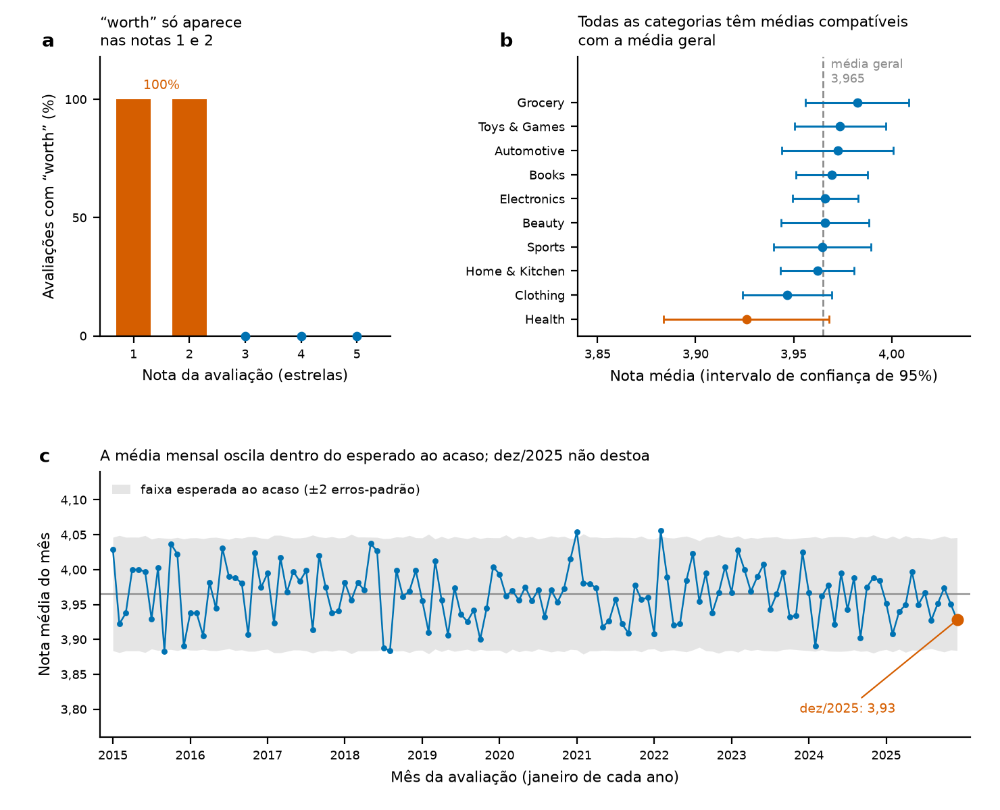

# Análise de avaliações de clientes da Amazon com SQL


**Em uma frase:** em 100.000 avaliações sintéticas de produtos (2015 a 2025), a nota média é 3,96 de 5 estrelas e 13,15% das avaliações têm nota 1 ou 2; ao testar as conclusões da análise, verificou-se que o termo "worth" coincide exatamente com o grupo de notas baixas (13.149 avaliações) e que as diferenças entre categorias e entre meses ficam dentro da variação esperada ao acaso.

**In short:** an SQL project (SQLite, DBeaver) that investigates 100,000 synthetic product reviews in four steps: data validation, overall performance, where and when satisfaction changes, and a text search for the cause of low ratings. The dataset was generated with ChatGPT to imitate the structure of the original Amazon reviews data, which was not accessible at the time. The figures reported in the original presentation were checked against the database and match. Follow-up checks show that the keyword "worth" appears in all 13,149 reviews rated 1 or 2 and in none of the others (the text was generated that way), and that differences between categories and between months are within chance variation. The conclusions therefore apply to this synthetic dataset only. The SQL scripts and the result of every query are included.

Projeto final da Pós-Graduação em Análise de Dados (Descomplica). A investigação seguiu quatro etapas, do geral para o específico, e terminou com uma etapa de validação que testou o que as consultas concluíram.

A pergunta que o projeto responde: **o que explica a insatisfação dos clientes, onde a empresa deve agir primeiro e quanto dessa resposta os dados sustentam?**

> **Status:** completo, com uma ressalva declarada: os dados são sintéticos, então as conclusões valem para este conjunto e não para clientes reais.

Apresentação do projeto: [`docs/Analise_Estrategica_de_Avaliacoes_Amazon.pdf`](docs/Analise_Estrategica_de_Avaliacoes_Amazon.pdf) (slides gerados no NotebookLM).

## Por que esses dados

Os dados foram gerados com o ChatGPT para imitar as avaliações de clientes da Amazon, porque o conjunto original não estava acessível na época. O banco tem a mesma organização de uma base real de avaliações (13 colunas, entre elas categoria, nota, data e texto), mas os valores e os textos são artificiais. O valor do projeto está no método: estruturar a investigação em etapas, escrever as consultas e checar o que elas permitem concluir.

## O que o projeto entrega

| Passo | Entrega | Onde |
|---|---|---|
| 1 | Validação da base: estrutura da tabela e volume (100.000 registros) | consultas 1 e 2 de `sql/01_analise_original.sql` |
| 2 | Desempenho geral: nota média e distribuição das notas | consultas 3 e 4 |
| 3 | Onde e quando: ranking de categorias e série mensal | consultas 5 e 6 |
| 4 | Causa provável: busca de palavras no texto das avaliações | consulta 7 |
| 5 | Validação das conclusões: 6 consultas adicionais, elaboradas depois da apresentação | `sql/02_validacoes_complementares.sql`; resultados em `docs/resultados/` |
| 6 | Apresentação final do projeto | `docs/Analise_Estrategica_de_Avaliacoes_Amazon.pdf` |

O script `sql/01_analise_original.sql` é o que foi entregue, sem alterações. Ele usa agregações (`COUNT`, `AVG`), uma subconsulta para calcular percentuais, `GROUP BY` com `HAVING` para ignorar categorias com poucas avaliações (`volume > 1000`), `STRFTIME` para agrupar por mês e `LIKE` com `LOWER` para buscar palavras no texto.

## Estrutura

```
analise-amazon-reviews-sql/
  sql/        01_analise_original.sql (7 consultas da apresentação)
              02_validacoes_complementares.sql (6 consultas de verificação)
  data/       amazon_customer_reviews_100k.sqlite (banco original, sintético, versionado)
              README.md (origem e esquema dos dados)
  docs/       apresentação em PDF, figuras/ (figura e script dos testes estatísticos)
              e resultados/ (CSV de cada consulta)
```

## Como reproduzir

O banco original é um SQLite com a tabela `amazon_reviews` (100.000 registros, 13 colunas, avaliações de 2015 a 2025) e está versionado neste repositório, em `data/amazon_customer_reviews_100k.sqlite` (cerca de 20 MB). A origem e o esquema estão em [`data/README.md`](data/README.md). A análise usa quatro colunas: `star_rating` (nota de 1 a 5), `category`, `review_date` (texto no formato `AAAA-MM-DD`, exigido pelo `STRFTIME`) e `review_text`.

No DBeaver, basta criar uma conexão SQLite apontando para esse arquivo e executar os dois scripts da pasta `sql/`.

Também é possível executar pela linha de comando do SQLite:

```bash
sqlite3 -header -column data/amazon_customer_reviews_100k.sqlite ".read sql/01_analise_original.sql"
```

O resultado de cada consulta no banco original está em [`docs/resultados/`](docs/resultados/), um CSV por consulta (`consulta_1.csv` a `consulta_7.csv` para a análise original e `consulta_C1.csv` a `consulta_C6.csv` para as verificações).

Os testes estatísticos e a figura da seção de validação são refeitos com o script em Python, que lê o mesmo arquivo `.sqlite` em modo somente leitura (requer `numpy`, `scipy` e `matplotlib`):

```bash
python docs/figuras/validacao_estatistica.py
```

## Resultados principais

Os números da apresentação foram conferidos no banco original e coincidem com ele:

| Indicador | Slides | Banco original |
|---|---|---|
| Universo analisado | 100.000 | 100.000 |
| Nota média geral | 3,96 | 3,96501 |
| Avaliações com nota 1 ou 2 | 13,15% | 13,149% (13.149 avaliações) |
| Categoria com maior / menor nota média | Grocery, 3,98 / Health, 3,93 | Grocery, 3,9824 / Health, 3,9259 |
| Mês apontado como mais fraco (dez/2025) | 3,92 | 3,9278 |
| Avaliações com "worth": quantidade / nota média | 13.149 / 1,61 | 13.149 / 1,6146 |

As avaliações se concentram nas notas altas: 74,8% têm 4 ou 5 estrelas.

| Nota | Avaliações | Percentual |
|---|---|---|
| 5 estrelas | 39.918 | 39,92% |
| 4 estrelas | 34.881 | 34,88% |
| 3 estrelas | 12.052 | 12,05% |
| 2 estrelas | 8.082 | 8,08% |
| 1 estrela | 5.067 | 5,07% |

A apresentação conclui que a insatisfação está ligada à percepção de custo-benefício (o cliente sente que o produto "não valeu o investimento") e propõe agir sobre comunicação e precificação. A próxima seção mostra o que a validação posterior diz sobre essa conclusão.

## O que a análise mostra (e o que não permite concluir)

Depois que a análise original foi reproduzida no banco, foram elaboradas seis consultas de verificação ([`sql/02_validacoes_complementares.sql`](sql/02_validacoes_complementares.sql)). Elas vieram depois da apresentação e seus resultados não aparecem nos slides. Os testes estatísticos e a figura foram calculados em Python (NumPy, SciPy e Matplotlib) pelo script [`docs/figuras/validacao_estatistica.py`](docs/figuras/validacao_estatistica.py), que lê o banco original e imprime todos os valores citados a seguir.



*Figura. (a) Percentual de avaliações que contêm "worth", por nota (n = 5.067, 8.082, 12.052, 34.881 e 39.918 avaliações para 1 a 5 estrelas). (b) Nota média por categoria, com intervalo de confiança de 95% (de 2.929 avaliações em Health a 17.955 em Electronics); a linha tracejada é a média geral, 3,965. (c) Nota média de cada um dos 132 meses (758 avaliações por mês, em média), com a faixa de ±2 erros-padrão em torno da média geral; dez/2025 está destacado.*

O banco tem 2.454 textos distintos em 100.000 avaliações, montados a partir de frases-modelo. Todas as 13.149 avaliações de nota 1 ou 2 terminam com "Not worth the price." e nenhuma avaliação de nota 3, 4 ou 5 contém essa expressão, enquanto o restante do texto varia sem relação com a nota: uma avaliação de 1 estrela diz, por exemplo, "Size and color match the description perfectly. Not worth the price."

Por isso a busca por "worth" devolve exatamente o grupo de notas baixas. A consulta C6 encontra 13.149 menções ao termo e 13.149 avaliações com nota 1 ou 2, e as mesmas 13.149 aparecem nos dois grupos (painel a); a C5 confirma que todas seguem o padrão "not worth". A consulta 7 devolve, portanto, o mesmo conjunto que se obtém filtrando as notas 1 e 2, e a nota média de 1,61 repete a média desse grupo. A busca por palavras funciona tecnicamente, mas afirmar que o custo-benefício causa a insatisfação exigiria um texto que variasse com o motivo da reclamação, como acontece em avaliações reais.

As categorias têm notas médias muito próximas, entre 3,926 (Health) e 3,982 (Grocery), cerca de 0,06 estrela numa escala de 5.

| Categoria | Avaliações | Nota média | Notas 1 e 2 (%) |
|---|---|---|---|
| Grocery | 7.108 | 3,982 | 12,79 |
| Toys & Games | 8.956 | 3,974 | 12,35 |
| Automotive | 6.056 | 3,972 | 13,01 |
| Books | 14.939 | 3,969 | 13,25 |
| Electronics | 17.955 | 3,966 | 13,16 |
| Beauty | 9.874 | 3,966 | 13,12 |
| Sports | 8.162 | 3,965 | 13,04 |
| Home & Kitchen | 13.989 | 3,962 | 13,01 |
| Clothing | 10.032 | 3,947 | 14,01 |
| Health | 2.929 | 3,926 | 14,37 |

O intervalo de confiança de 95% de cada categoria contém a média geral (painel b). A análise de variância (ANOVA) entre as dez categorias resulta em p = 0,45, e Health contra as demais resulta em p = 0,07 (teste t de Welch). No percentual de notas 1 e 2, Health tem 14,37% contra 13,11% nas demais (teste exato de Fisher, p = 0,049), valor no limite do critério usual e obtido sem correção para as dez categorias comparadas. Na prática, os dados oferecem só um indício fraco de que Health se distingue das outras.

A nota média de dez/2025 é 3,928, o 26º menor valor entre os 132 meses da base. Em 2025, fevereiro (3,908) tem média menor, e agosto (3,9275) praticamente empata com dezembro. Com cerca de 758 avaliações por mês, o erro-padrão da média mensal é de aproximadamente 0,04, e a faixa de ±2 erros-padrão do painel c cobre quase todos os meses: apenas 4 dos 132 ficam fora, número próximo dos cerca de 7 esperados só por acaso. Dez/2025 contra os demais meses de 2025 resulta em p = 0,58 e, considerando os 11 anos, dezembro tem média 3,9745 contra 3,9641 dos demais meses (p = 0,42). O gráfico do slide 8 também não reproduz as médias mensais do banco: janeiro de 2025 aparece perto de 4,02 no slide e vale 3,95 no banco, e apenas o ponto de dezembro corresponde.

Os slides truncam alguns valores em vez de arredondá-los. A nota média geral, 3,96501, aparece como 3,96 (arredondada seria 3,97), e dez/2025, 3,9278, aparece como 3,92.

Seguem válidos a integridade da base (consulta C1: sem valores nulos e com todas as notas entre 1 e 5), o volume anunciado, a distribuição das notas, com 13,15% de avaliações de nota 1 ou 2, e a estrutura de investigação em quatro etapas, que com dados reais poderia ser aplicada sem alteração.

## Recomendações da apresentação

A apresentação propõe quatro ações: revisar a comunicação de marketing, principalmente em Health e Clothing; usar a categoria Grocery como referência interna de boas práticas; criar painéis de monitoramento com alertas para termos como *worth*, *price* e *quality*; e evoluir da busca por palavras para modelos de processamento de linguagem natural (NLP). Diante da validação acima, as duas primeiras dependem de confirmar a diferença entre categorias em dados reais, e a última é o passo que permitiria tirar conclusões sobre causas a partir do texto.

## Tecnologias

SQL, SQLite e DBeaver. Os testes estatísticos e a figura da seção de validação usam Python (NumPy, SciPy e Matplotlib).

## Autora

**Vanessa Meneghini**

Licença [MIT](LICENSE).
